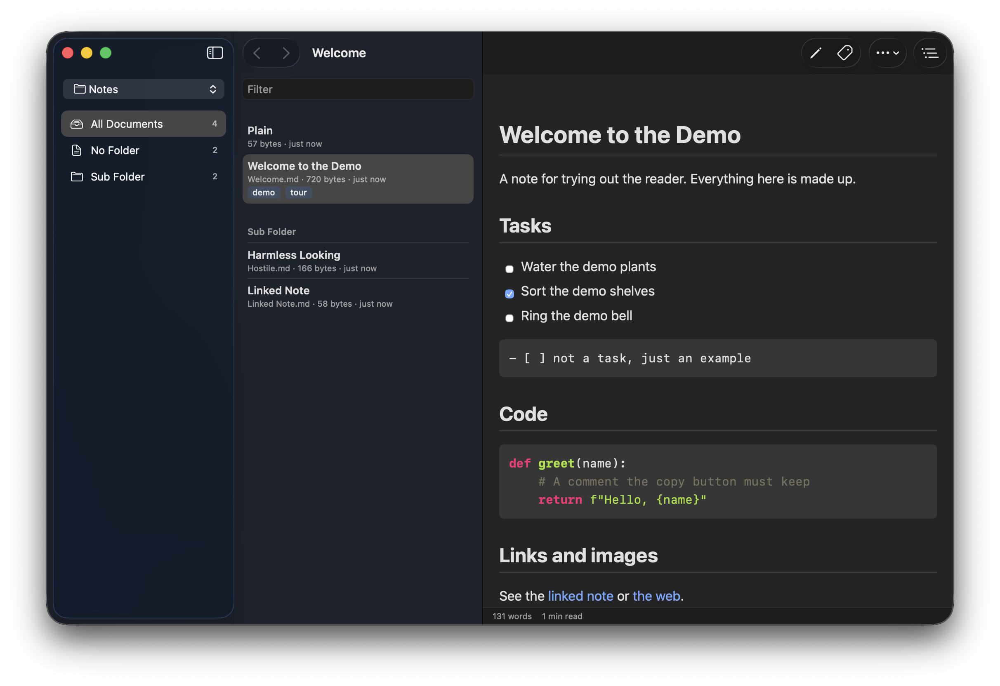
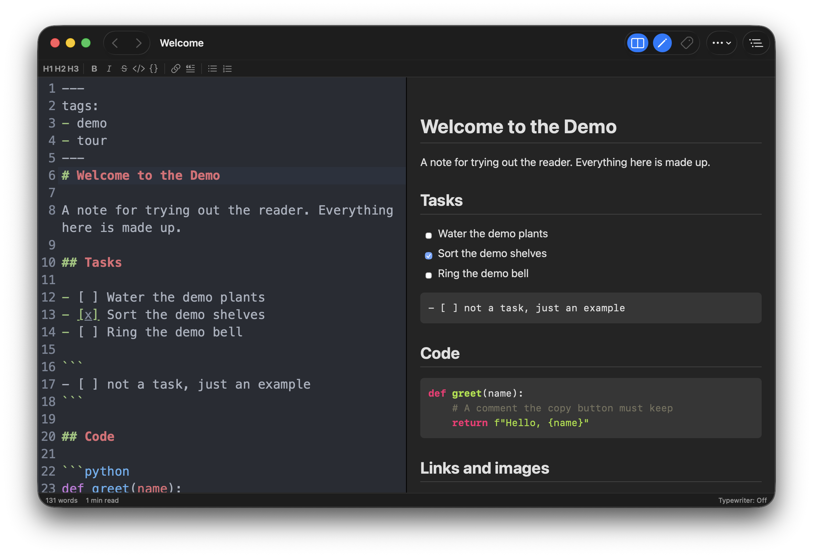

# Stenmark for macOS

Your markdown librarian: a native macOS Markdown reader, organiser and editor, rebuilt
in Swift and SwiftUI from [Stenmark for Linux](https://github.com/mkay/stenmark). The
editor is CodeMirror 6, hosted in a `WKWebView`.

**[Download the latest release](https://github.com/mkay/stenmark-mac/releases/latest)**






## Features

- Browse a folder of Markdown notes, with pinned notes and folders, tags and full-text search
- A CodeMirror 6 editor with a live preview, 48 colour themes and typewriter mode
- Double-click any word to edit it; go back to the reader at the line you reached
- Task lists you can tick in the reader
- Export to PDF, print, and copy as rich text
- English, German and Russian

Made to share a synced folder with the Linux app. Notes and their frontmatter are written
exactly as Linux writes them, and a change arriving from another machine is never
overwritten without asking.

## Installing

Download `Stenmark-<version>.dmg` from the [latest release](https://github.com/mkay/stenmark-mac/releases/latest)
and drag Stenmark into Applications. It needs macOS 15 or later, on Apple Silicon or Intel.

Stenmark isn't notarised by Apple, so the first launch needs one extra step:

1. Open Stenmark. macOS says it can't verify that Stenmark is free of malware and doesn't
   open it. The dialog only offers **Done** and **Move to Bin**; choose **Done**.
2. Open **System Settings → Privacy & Security**, scroll to the bottom, and click
   **Open Anyway** next to the message about Stenmark. Enter your password. The button
   only appears for about an hour after the blocked attempt, so try opening Stenmark again
   if it's missing.

If you prefer the Terminal, this clears the flag instead:

```sh
xattr -dr com.apple.quarantine /Applications/Stenmark.app
```

After that it opens normally. Updates arrive through **Stenmark → Check for Updates…**
(and automatically, if you allow it), signed with Stenmark's own update key, and don't
need this step again.

## Layout

| Path | What |
|---|---|
| `App/` | The SwiftUI app target |
| `Packages/StenmarkCore/` | Notes, frontmatter, saving, search, the folder watcher. No UI imports. |
| `Packages/StenmarkWeb/` | `WKWebView` hosts, the `stenmark://` scheme handler, built web bundles |
| `web/editor/` | CodeMirror source, from the Linux app |
| `web/reader/` | The Markdown renderer: markdown-it and highlight.js |
| `project.yml` | XcodeGen spec. `Stenmark.xcodeproj` is generated, not checked in. |

## Building

Requires Xcode 26 or later and [XcodeGen](https://github.com/yonaskolb/XcodeGen)
(`brew install xcodegen`).

```sh
xcodegen generate
open Stenmark.xcodeproj
```

Tests:

```sh
(cd Packages/StenmarkCore && swift test)
(cd Packages/StenmarkWeb && swift test)
```

The web bundles are committed. After changing `web/`, rebuild them with Node:

```sh
(cd web/editor && npm ci --ignore-scripts && npm run build)
(cd web/reader && npm ci --ignore-scripts && npm run build)
```

`scripts/make-frontmatter-fixtures.py` regenerates the frontmatter test fixtures from the
Linux app's own code. It needs PyYAML.

## Translations

The strings live in String Catalogs: `App/Localizable.xcstrings`, and one in each package.
After changing user-visible text, run `scripts/sync-strings.sh`: it adds new strings to the
catalogs and lists the ones still lacking a translation. Terms follow the Linux app's
`po/de.po` and `po/ru.po`. Russian strings that don't come from there are marked for review.

## Releasing

```sh
# Update App/Resources/whatsnew.md, commit, then:
scripts/release.sh 0.2.0            # → dist/0.2.0/Stenmark-0.2.0.dmg and appcast.xml
scripts/release.sh 0.2.0 --publish  # also creates the GitHub release (needs gh)
```

Releases are signed with an Apple Development certificate and aren't notarised. The build
number is the commit count. The update feed is the newest GitHub release's `appcast.xml`,
signed with Sparkle's EdDSA key from the login Keychain of whoever releases, under the
account `stenmark` (`build/tools/sparkle/bin/generate_keys --account stenmark -x file`
exports it for backup).

## License

GPL-3.0-**only**. See [LICENSE](LICENSE) and [COPYRIGHT](COPYRIGHT).
